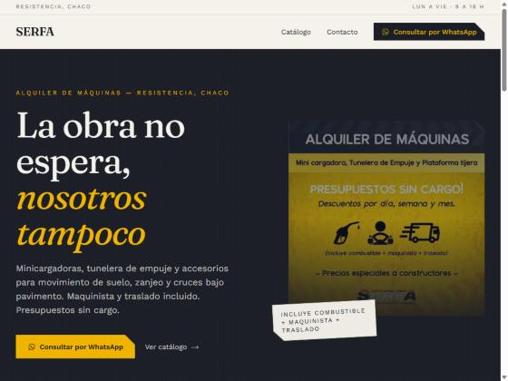
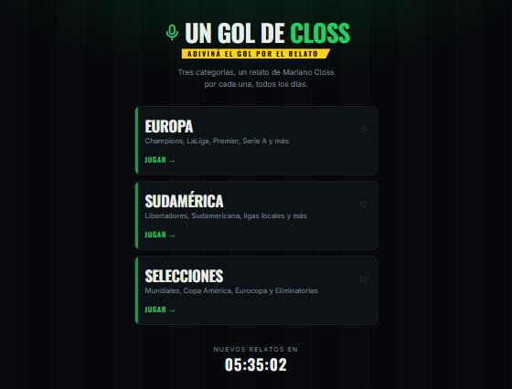
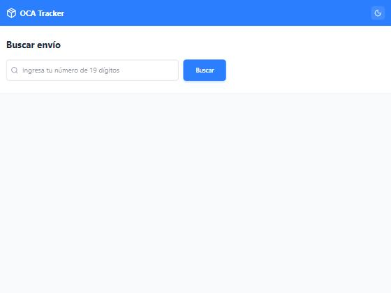
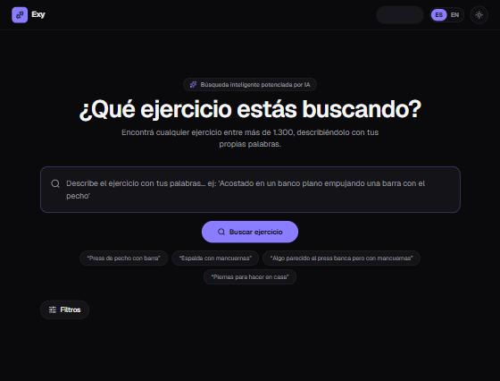

# Alan Quenardelle

Desarrollador web full-stack con experiencia en proyectos reales para clientes. Estudiante de Ingeniería en Sistemas de Información en UTN FRRe (Resistencia, Chaco).

---

## 🛠 Stack

---

## 💼 Proyectos

### 🏗️ SERFA Servicios — sitio web para cliente
Sitio institucional para empresa de alquiler de máquinas viales en Resistencia, Chaco. Catálogo de equipos, integración con WhatsApp y diseño responsive.

---

### 🎙️ Un Gol de Closs
Juego diario estilo Heardle con relatos de goles de Mariano Closs. Tres categorías (Europa, Sudamérica, Selecciones), un relato por categoría renovado a las 00:00 de Buenos Aires. 6 intentos con fragmentos de audio de 1 a 16 segundos.

**Stack:** Next.js 15 · TypeScript · Tailwind CSS v4 · Supabase

---

### 📦 OCA Tracker
Seguimiento de envíos de OCA con una interfaz limpia y rápida, mejor que el sitio oficial.

---

### 🏋️ Exy — Exercise Finder AI
Buscador inteligente de ejercicios de gimnasio: describís el ejercicio con tus propias palabras (en cualquier idioma) y la app lo encuentra dentro de un dataset de más de 1.300 ejercicios, con GIF, músculos trabajados, equipamiento e instrucciones.

---

## 📫 Contacto

